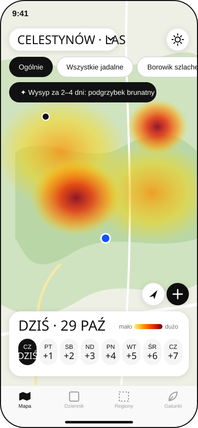
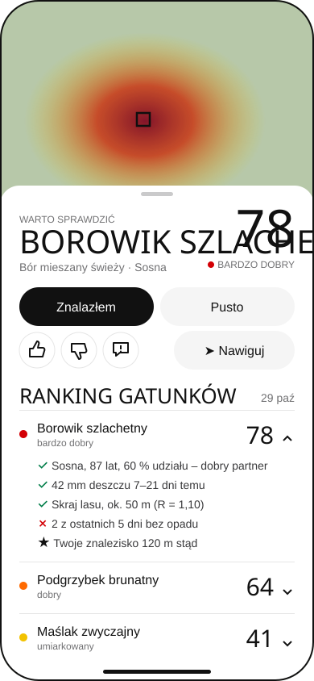
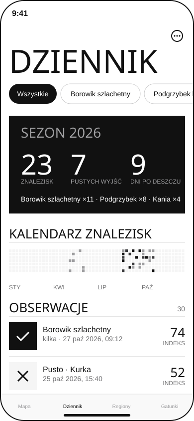
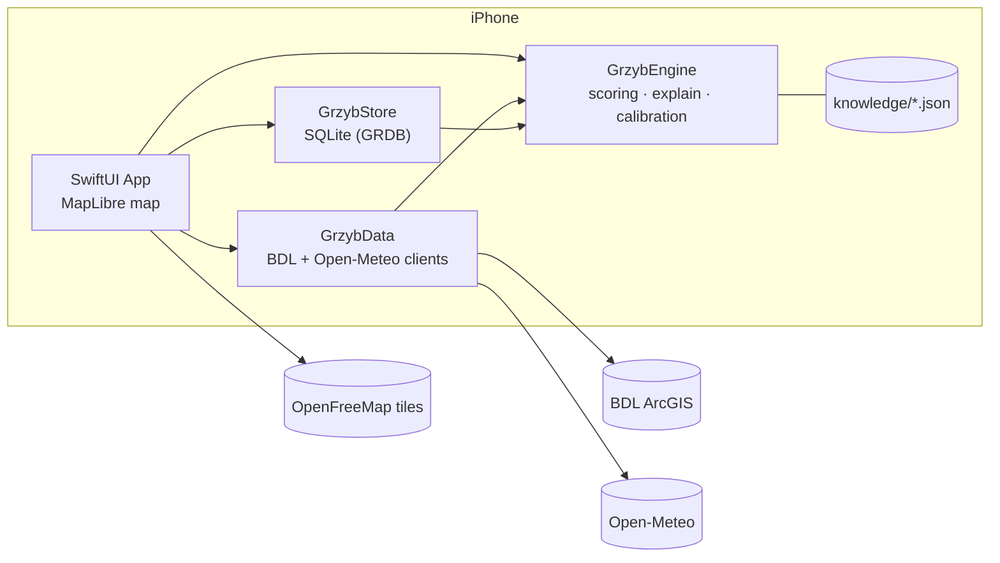

# Grzyby – grzybowa mapa

**An offline iPhone map that tells you where in a Polish forest mushrooms are most likely to grow today, and explains why.**

Grzyby computes a rule-based potential index (0–100) for every 100 m forest cell from public forest-inventory data (BDL), weather and soil conditions (Open-Meteo) and your own field observations. Everything runs on the phone. There is no backend, no account and no LLM.

> The app does not identify mushrooms. Only pick what you know for certain.

<p align="center">
  
  &nbsp;
  
  &nbsp;
  
</p>

## Why

Mushroom pickers combine many clues: tree species and stand age, forest site type, how much it rained one to three weeks ago, soil temperature, frost, and their own past finds. Grzyby puts those clues together on a map, shows the result for today and the next seven days, and spells out every factor as a ✓ / ✗ / ★ reason, so you can judge it yourself.

## Features

- **Region download** – draw a rectangle up to 30 × 30 km; the app fetches forest stands and sites from BDL, builds a 100 m grid, downloads weather and caches map tiles (zoom 10–16) for offline use.
- **Potential map** – smooth "Ogólnie" heatmap of overall potential, or a four-band overlay per species / for all edible species, with a day selector from today to +7 days.
- **Explainable scores** – tap any cell to see the species ranking, the reasons behind each score, source data (stand, age, site, data year) and a 21-day rainfall chart.
- **Field observations** – log a find or an empty visit in up to three taps (long-press on the map or "+"), with photo, note and amount; rate cells 👍 / 👎 or correct the terrain.
- **Personalization** – a local prior around your finds and automatic calibration every 10 observations (one logged parameter change at a time, with undo).
- **Flush alerts** – detects weather patterns that precede a flush and shows a banner plus an optional local notification (max one per day).
- **Journal** – season summary, find calendar, filter by species, JSON backup / import and GPX export.
- **Species & rules** – 15 Polish edible species with editable parameters; all numbers live in JSON.
- **Field mode** – higher-contrast overlay and screen kept awake; in-app compass navigation to a cell or a past find.

## Architecture



The engine is a plain Swift package with no UI dependency, so the scoring logic, tests and a CLI run on macOS. See [docs/architecture.md](docs/architecture.md) for the module breakdown, the download/scoring sequence and the scoring formula.

## Tech stack

| Area | Technology |
| --- | --- |
| App | Swift 5 mode, SwiftUI, Observation, Swift Charts, iOS 17+ (iPhone, portrait) |
| Map | [MapLibre Native](https://github.com/maplibre/maplibre-gl-native-distribution) 6.31 with [OpenFreeMap](https://openfreemap.org) vector tiles |
| Engine | Swift package (swift-tools 6.0), XCTest |
| Storage | SQLite via [GRDB.swift](https://github.com/groue/GRDB.swift) 7.11 |
| Data | [BDL](https://www.bdl.lasy.gov.pl) ArcGIS REST (forest stands and sites), [Open-Meteo](https://open-meteo.com) forecast API |
| Project | [XcodeGen](https://github.com/yonaskolb/XcodeGen) (`project.yml`), Makefile |
| Type | Bebas Neue (SIL Open Font License) |

## Getting started

### Prerequisites

- macOS with Xcode 16 or newer (iOS 17 SDK)
- [Homebrew](https://brew.sh) (used to install XcodeGen)
- An Apple ID / developer team to run on a physical iPhone (not needed for the simulator)

### Install

```bash
git clone https://github.com/michalilski/grzybapp.git
cd grzybapp
make setup        # installs xcodegen if missing, creates Config/Local.xcconfig, generates Grzyby.xcodeproj
```

### Configure signing

Edit `Config/Local.xcconfig` (gitignored):

```
DEVELOPMENT_TEAM = YOUR_TEAM_ID
PRODUCT_BUNDLE_IDENTIFIER = com.example.grzybapp
```

No API keys are required: BDL, Open-Meteo and OpenFreeMap are public and keyless.

### Run

```bash
make open         # opens Xcode; pick your iPhone or a simulator and press Run
make build        # command-line simulator build without signing (SIMULATOR="iPhone 17" by default)
```

### Engine tests and CLI

```bash
make test                                         # swift test in Engine/
make cli DATE=2026-10-09 SPECIES=boletus_edulis   # rank cells of the fixture region
make golden                                       # rewrite expected_ranking.json after a deliberate heuristic change
```

Debug-only launch options for the simulator: the `-demoRegion` argument seeds a 5 × 5 km region near Celestynów; the `DEMO_TAB=cell|journal|regions|species` environment variable opens a given screen.

## Project structure

```
grzybapp/
├── App/                      SwiftUI application
│   ├── Core/                 composition root, downloader, weather, tiles, renderer, location, notifications
│   ├── Design/               theme tokens and reusable components
│   ├── Features/             Map, CellDetails, Observation, Journal, Regions, Species, Navigate, Onboarding
│   ├── Models/               @Observable app state
│   └── Resources/            assets, Bebas Neue font
├── Engine/                   Swift package (no UI)
│   ├── Sources/GrzybEngine/  scoring, weather index, grid, knowledge base, personalization
│   ├── Sources/GrzybData/    BDL and Open-Meteo clients, GeoJSON parser
│   ├── Sources/GrzybStore/   SQLite schema, repositories, export/import
│   ├── Sources/score-cli/    command-line ranking tool
│   └── Tests/                unit, golden-ranking, personalization and store tests with fixtures
├── Config/                   xcconfig files (Local.xcconfig is gitignored)
├── docs/                     architecture, original product spec (Polish), mockups
├── project.yml               XcodeGen project definition
└── Makefile
```

## Configuration

| What | Where |
| --- | --- |
| Signing team, bundle id | `Config/Local.xcconfig` (copy of `Config/Local.xcconfig.example`) |
| Species parameters (season, hosts, age, sites, weather lag) | `Engine/Sources/GrzybEngine/Resources/knowledge/species.json` |
| Site-type (TSL) profiles | `.../knowledge/tsl_profiles.json` |
| Weights, band thresholds, calibration, general heatmap bonus | `.../knowledge/engine_params.json` |
| Polish explanation templates | `.../knowledge/explain_pl.json` |
| BDL code dictionaries | `.../knowledge/codes.json` |

Adding a species currently means adding a record to `species.json`. Species values are approximate atlas knowledge (`source: atlas`) and are meant to be refined by field calibration.

## Design decisions

- **Native Swift instead of Flutter** – iPhone-only target; module boundaries from the spec are kept (the engine has no UI dependency).
- **BDL over HTTP** – the BDL map server rejects HTTPS (403), so the app has an ATS exception for `mapserver.bdl.lasy.gov.pl` only. Stand layers carry only the dominant species and its share; the remainder is inferred from the site's forest type.
- **Moisture** comes from the TSL suffix; the water factor is the max of the rain curve and the soil-moisture curve, minus a dry-day penalty, with partial relief on moist sites so a dry spell does not zero every cell.
- **Not in v1** – terrain model (NMT), multi-point weather interpolation for large regions, distance to roads, adding species in the UI.

The original product specification (in Polish) is in [docs/spec-pl.md](docs/spec-pl.md).

## Privacy

Location, photos and observations stay on the device in a local SQLite database. Network requests go only to BDL, Open-Meteo and OpenFreeMap and contain region coordinates, never your observations.

## License

Released under the [MIT License](LICENSE). © 2026 Michał Ilski.

Forest data © Bank Danych o Lasach / PGL Lasy Państwowe; weather data by [Open-Meteo](https://open-meteo.com) (CC BY 4.0); map data © OpenStreetMap contributors via OpenFreeMap; Bebas Neue is licensed under the SIL Open Font License 1.1.
