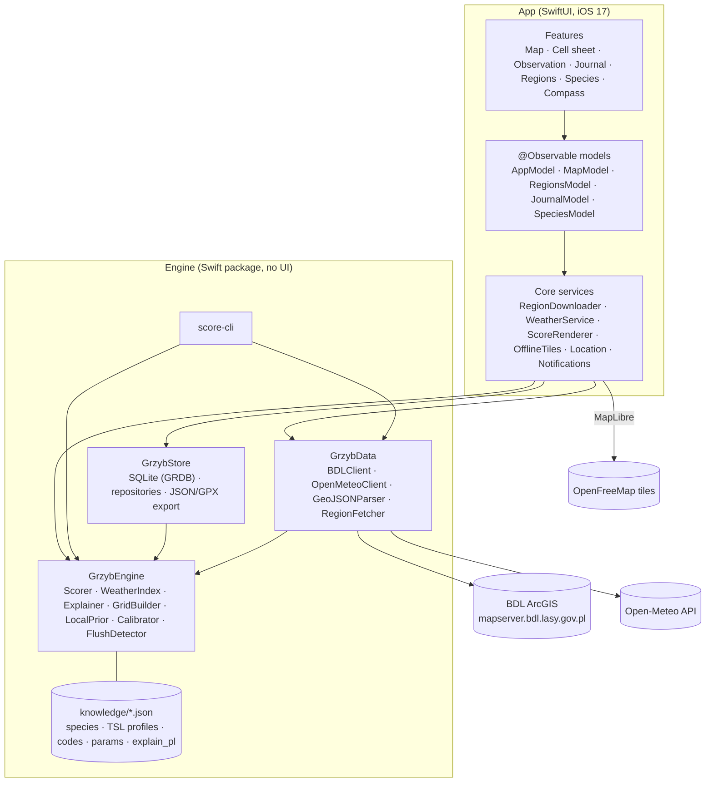
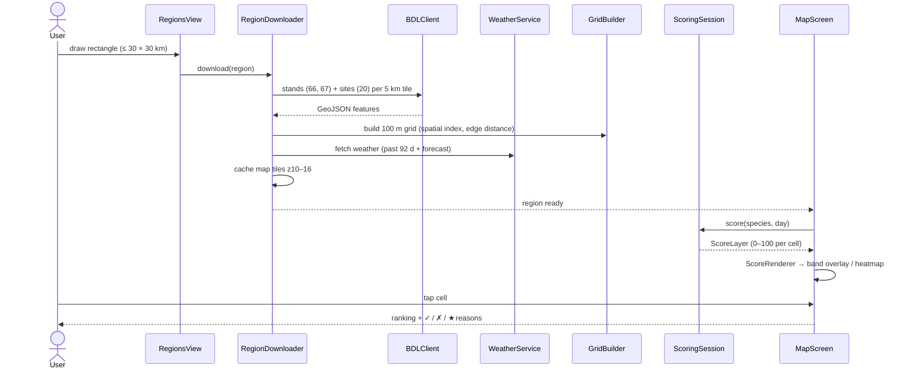

# Architecture

Grzyby is an offline-first iPhone app. All computation happens on the device; the only network calls fetch public data (forest stands, weather, map tiles) when a region is downloaded or refreshed.

## Modules



| Module | Responsibility |
| --- | --- |
| `GrzybEngine` | Pure scoring logic. Builds the 100 m grid from forest polygons, computes per-species factors, explains them in Polish, learns from observations. Every tunable number lives in `Resources/knowledge/*.json`. |
| `GrzybData` | Network clients: BDL ArcGIS REST (stands layers 66/67, sites layer 20, paged 5 km tiles) and Open-Meteo (past 92 days + 16-day forecast, soil temperature and moisture). |
| `GrzybStore` | SQLite schema, repositories for regions, weather, observations, rules and settings; JSON backup/import and GPX export. |
| `score-cli` | Command-line ranking of a fixture region, used for phase-0 validation and debugging heuristics. |
| `App` | SwiftUI UI, MapLibre map, composition root (`AppServices`), background region download, offline tiles, local notifications. |

## Region download and scoring flow



## Scoring model

For each cell and species:

```
S = 100 · H · A · T · P · F · W_rain · W_temp · W_frost · R · U
```

| Factor | Meaning |
| --- | --- |
| `H` | Host tree match (mycorrhizal partners, stand share) |
| `A` | Stand age within the species' optimum (trapezoid) |
| `T`, `P` | Site type (TSL) suitability and penalties (e.g. former arable land) |
| `F` | Season curve by day of year |
| `W_rain` | max(rain curve, soil-moisture curve × 0.8) minus dry-day penalty, relieved on moist sites |
| `W_temp`, `W_frost` | Soil temperature range, recent frost |
| `R` | Terrain / structure (forest-edge distance) |
| `U` | Personal multiplier: local prior from your observations (σ = 150 m) and calibrated parameters |

The **Ogólnie** (general) heatmap combines species: best score plus `general_diversity_bonus` × (gap to "any of" `1 − Π(1 − sᵢ/100)`).

Bands: low < moderate < good < very good, thresholds in `engine_params.json` (`very_good` = 71).

## Personalization

- Every observation stores `score_at_time`, factors and context.
- `LocalPrior` raises or lowers potential near your finds and empty visits.
- `Calibrator` runs every 10 observations, changes at most one parameter, logs it and supports undo / restore atlas defaults.
- `FlushDetector` looks for rain + temperature patterns that precede a flush and triggers a banner and an optional local notification (max one per day).

## Storage

SQLite via GRDB in `Application Support/Grzyby/grzyby.sqlite`; photos and stand outlines are files next to it. Nothing leaves the device unless you export it.
